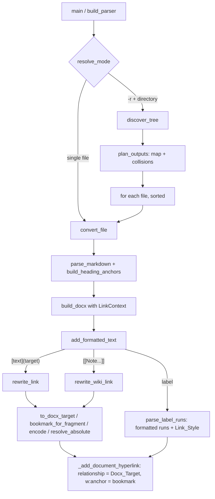

# Design Document: Sibling Markdown Links

## Overview

This feature makes links between Markdown files survive conversion. A link such as `[Setup](docs/setup.md#install)` becomes a hyperlink in the output whose external relationship target is `docs/setup.docx` and whose `w:anchor` attribute is the heading bookmark `_toc_install`. Obsidian wiki links (`[[Note]]`, `[[Note|Label]]`, `[[Note#Heading]]`) become hyperlinks the same way. The feature has four parts:

1. **Link rewriting.** A pure, testable layer classifies a link target, rewrites it to a `.docx` target, converts the fragment to the heading bookmark name, and percent-encodes the path.
2. **Absolute links.** With `--link-base-url`, the rewritten target is resolved against a base URL so the link works where relative paths do not (Word for the web on SharePoint).
3. **Recursive conversion.** `-r/--recursive` converts every Markdown file under a directory. `-o`/`--outdir` mirrors the source layout under another directory.
4. **Opt-out.** `--no-sibling-links` yields exactly the output the Converter produced before this feature existed.

All code stays in `src/md_to_docx/md_to_docx.py`. The README states that the file also runs standalone with `uv run` (PEP 723), so the feature adds no new module and no new runtime dependency (only the standard library: `urllib.parse`, `posixpath`, `hashlib`, `unicodedata`, `dataclasses`, `os`).

### Findings from the existing code that shape the design

These come from reading `md_to_docx.py`, `README.md`, and `tests/test_converter.py`, and from running the converter on a sample file.

| Finding | Consequence |
| --- | --- |
| `add_formatted_text` turns `[text](target)` into a `\x00LINK\x00target\x00label\x00` token. Only `#anchor` targets and `http(s)://`/`mailto:` targets become hyperlinks. Every other target, including `setup.md`, renders as **plain label text**. A check on `[Setup](setup.md#x)` and `[[Note]]` produced no `w:hyperlink` at all. | The requirements Introduction says such links are written as external hyperlinks to `setup.md`. They are not. Requirement 7.2 settles what "before this feature" means: plain text (Design Decision 6). |
| Heading bookmarks are named `_toc_{idx}_{slug}` in `build_heading_anchors`, where `idx` is the heading's position in the block list. Slugs can contain hyphens and can exceed 40 characters. | A link in file A cannot know `idx` for a heading in file B without parsing B, and Requirements 2.5 and 2.7 to 2.8 demand a name that is index-free, at most 40 characters, and limited to letters, digits and underscores. The naming must change (Design Decisions 1 and 2). |
| `_build_hyperlink_run(text)` builds one `w:r` with the `Hyperlink` rStyle and a single `w:t`. `_add_external_hyperlink(paragraph, text, url)` wraps it in a `w:hyperlink` with an `r:id`. `_add_internal_hyperlink` uses `w:anchor`. `_render_inline(paragraph, text, flags)` renders emphasis and code recursively by stacking `flags`. | Hyperlink labels are currently one unformatted run. Requirement 1.10 needs a label renderer that produces formatted runs inside the hyperlink (Design Decision 4). |
| Obsidian wiki links are flattened to plain text by two regexes before tokenizing. `[[#Heading]]` is already tokenized into a LINK token with a `#` target and resolved by `_resolve_internal_anchor`. | `[[Note...]]` forms get their own token. `[[#Heading]]` handling stays as is. |
| `build_docx(...)` threads `anchors`, `base_dir`, `allow_remote_images` through `_render_list_block` and `add_formatted_text`. `base_dir` is already the Source_File's resolved directory. | One new optional `link_ctx` argument is threaded the same way. `base_dir` is reused for existence checks. |
| `main()` takes two optional positionals (`input`, `output`), checks that the input exists, calls `check_output_writable` (which prints to stdout and calls `sys.exit(1)`), and then builds. `build_docx` prints `Saved: ...` and saves directly to the output path. | Conversion of one file is extracted into `convert_file`. `check_output_writable` is split into a message-returning check so a locked file in a tree does not abort the run. `build_docx` gains an `announce` flag. |
| The dev dependency group contains only `pytest>=8`. | `hypothesis` is added to the dev group for property tests. |

## Architecture



### Layers

- **Pure link layer.** Functions with no I/O and no docx dependency: `parse_link_target`, `to_docx_target`, `bookmark_name`, `bookmark_for_fragment`, `percent_decode`, `encode_path`, `normalize_base_url`, `resolve_absolute`, `wiki_parts`. Property tests target this layer.
- **Link context.** A small frozen dataclass, `LinkContext`, carries options and the Source_File identity into rendering. It also holds the warning sink, which keeps the I/O (stderr, filesystem existence checks) at one edge.
- **Rendering.** `add_formatted_text` consults the link layer when it meets a LINK or WIKI token, renders the label into formatted runs, and calls `_add_document_hyperlink`.
- **Orchestration.** `resolve_mode`, `discover_tree`, `plan_outputs`, `convert_file`, `convert_tree`, and `main` handle files, directories, and exit status.

### Design decisions

1. **Bookmark names are index-independent: `bookmark_name(slug)`.** Requirement 2.2 requires the link fragment to equal the target heading's bookmark name character for character, and 2.5 requires this even when the target file cannot be read. A name that depends only on heading text makes `bookmark_for_fragment(fragment)` a pure function, so no file read or cross-file coordination is needed, and the same function serves same-file and cross-file links. Alternative considered: parse the target file and look up `idx`. It fails Requirement 2.5, doubles parse cost in recursive mode, and breaks when the target is generated or missing.
2. **Bookmark naming rules (Requirements 2.7 and 2.8).** `bookmark_name(slug)` is deterministic and applies these steps:
   1. Sanitize the slug to ASCII: apply NFKD, drop combining marks, replace each run of characters outside `[A-Za-z0-9]` with a single `_`, and strip leading and trailing `_`. Underscores in the input are kept as the only separator.
   2. If the sanitized body is empty and the slug is empty, the body is `section`. If the body is empty but the slug is not (for example a heading written only in a non-Latin script), the body is `h_` plus the first 8 hex digits of the SHA-1 of the slug's UTF-8 bytes. This keeps such headings addressable and distinct.
   3. The name is `_toc_` plus the body. The prefix guarantees the name starts with an underscore.
   4. If the name is longer than 40 characters, it is replaced by its first 31 characters, then `_`, then the first 8 hex digits of the SHA-1 of the full, untruncated name. The result has exactly 40 characters. The hash covers the whole slug, so two long headings with the same first 31 characters get different names, and the same heading always gets the same name.
   5. Uniqueness inside one document: `build_heading_anchors` numbers repeated GitHub-style slugs (`install`, `install-1`, `install-2`) and passes the numbered slug through `bookmark_name`, so the length rule applies after numbering. A final `used` set check increments the counter if two different slugs still produce the same name (for example `a-b` and `a_b`, both sanitized to `a_b`).
   The only characters in a name are `A-Za-z0-9_`, and the first is `_`, so every name is a valid Word bookmark name.
3. **Fragment conversion is `bookmark_name(slugify_heading(percent_decode(fragment)))`.** It accepts both GitHub-style slugs (`install-steps`) and raw heading text (`Install Steps`), as `_resolve_internal_anchor` already does for same-file links. A numbered duplicate heading is reachable through its numbered slug (`#install-1`). A long heading is reachable through its full slug or full text, because the truncation and hash are part of `bookmark_name`.
4. **Hyperlink labels keep inline formatting (Requirement 1.10).** The label of a LINK token or the `Label` of `[[Note|Label]]` is not passed to `_build_hyperlink_run` as a single string. A new function `parse_label_runs(label)` reuses the same inline tokenizer that `_render_inline` uses and returns a list of `RunSpec(text, flags)` where `flags` is the set of active formats (bold, italic, code, and the other inline flags `_render_inline` supports). `_add_document_hyperlink` builds one `w:r` per `RunSpec` inside the single `w:hyperlink` element. Each run gets the same run properties (`w:b`, `w:i`, code font, and so on) as the same text would get outside a link, built by the existing flag-to-rPr code that `_render_inline` uses (extracted into a helper `_apply_run_flags(run, flags)` that both paths call), plus the `Hyperlink` rStyle. Nested links inside a label are flattened to their text so a hyperlink never contains another hyperlink. The unformatted label case yields one run, identical to today's `_build_hyperlink_run` output, so existing `http(s)` and `mailto:` links are unchanged. The visible text of `[[Note#Heading]]` without a label is the unformatted string `Note#Heading`.
5. **Hyperlinks to other documents use an external relationship plus `w:anchor` (Requirements 2.6 and 8.6).** `_add_document_hyperlink(paragraph, href, anchor, runs)` calls `part.relate_to(href, RT.HYPERLINK, is_external=True)`, sets `r:id` on the `w:hyperlink`, and sets `w:anchor` to the bookmark name when there is one. The relationship target is the Docx_Target (relative path or Absolute_Link) and never contains `#`. This is how Word itself stores a link to a bookmark in another file, so Word on the desktop and on the web can follow it. Same-document links keep using `_add_internal_hyperlink` (anchor only, no relationship). `http(s)` and `mailto:` links keep `_add_external_hyperlink`.
6. **`--no-sibling-links` yields exactly the pre-feature output (Requirement 7.2).** This is a stated decision, not an open question. When the option is given, `link_ctx.enabled` is false and the Converter takes the old code paths: every link that is not an internal anchor or `http(s)`/`mailto:` renders as plain label text, wiki links other than `[[#Heading]]` flatten to plain text, labels render exactly as before, and `build_heading_anchors` uses the legacy `_toc_{idx}_{slug}` naming, so the document XML is byte-for-byte what the previous version wrote. The new naming rules of Decision 2 apply only when links are enabled. The option wins over `--link-base-url` (Requirement 8.13): the base URL is still validated, but no Absolute_Link is formed. Requirement 3.6 ("same as before") is met by the same old paths.
7. **Wiki links get a separate `WIKI` token** and do not synthesize a Markdown target. A wiki note with a non-Markdown extension (`[[a.txt]]`) must produce `a.txt.docx`, which the sibling classifier would reject.
8. **All new code is pure-stdlib and in one file**, matching the standalone-script contract in the README.
9. **Base URL query and fragment are dropped with a Warning.** SharePoint folder URLs sometimes carry `?id=...`. Joining a path after a query is meaningless. Requirements are silent, so the design strips them and warns once. This is easy to remove.
10. **`--sharepoint` adds `?web=1` and understands library view URLs (Requirement 14).** SharePoint downloads a `.docx` reached by its plain file URL and opens it in Word for the web when the URL ends in `?web=1`; this was confirmed on the user's tenant. The suffix is a fixed string held in `LinkContext.link_suffix` and appended after `resolve_absolute`, so the path model and Properties 17 to 19 are unchanged. The option also accepts the address a browser shows for a library folder (`.../Forms/AllItems.aspx?id=<server-relative path>`), because users copy that address and Decision 9 would otherwise turn it into links under `.../Forms/AllItems.aspx/`. Alternative considered: a generic `--link-query QUERY` option. It is more flexible but needs the user to know the SharePoint parameter, and it does not solve the view-URL problem. The fragment stays in `w:anchor`; Word for the web may ignore it, which the README states.

## Components and Interfaces

### New and changed functions in `md_to_docx.py`

#### Pure link layer

```python
@dataclass(frozen=True)
class SiblingTarget:
    path: str        # decoded, forward slashes, original extension
    fragment: str    # decoded, "" when absent or empty

_SCHEME_RE   = re.compile(r"^[A-Za-z][A-Za-z0-9+.\-]*:")
_MD_EXT_RE   = re.compile(r"\.(?:md|markdown)$", re.IGNORECASE)
_PCT_RUN_RE  = re.compile(r"(?:%[0-9A-Fa-f]{2})+")
_PCT_SEQ_RE  = re.compile(r"%[0-9A-Fa-f]{2}")
_SAFE_PATH   = "/-._~"
BOOKMARK_MAX = 40

def percent_decode(s: str) -> str: ...
def parse_link_target(raw: str) -> "SiblingTarget | None": ...
def to_docx_target(raw_path: str) -> str: ...
def bookmark_name(slug: str) -> str: ...
def bookmark_for_fragment(fragment: str) -> str: ...
def encode_path(path: str) -> str: ...
def normalize_base_url(raw: str) -> str: ...        # raises ValueError
def resolve_absolute(base: str, source_dir: tuple, docx_path: str) -> tuple[str, bool]: ...
def wiki_parts(inner: str) -> "WikiLink | None": ...
```

**`percent_decode(s)`** replaces each maximal run of `%XX` sequences with its UTF-8 decoding. A run that is not valid UTF-8 is left as written, as is a `%` not followed by two hex digits (Requirement 5.4). It never raises.

**`parse_link_target(raw)`** returns a `SiblingTarget`, or `None` when the link is not a Sibling_Link. Steps:

1. `s = raw.strip()`. If `s` is empty, return `None` (3.5).
2. If `s` starts with `<`: take the text up to the first `>`. If there is no `>`, return `None` so the label renders as plain text (5.2, 5.5). Otherwise `s` is that text, with spaces preserved.
3. If `s` starts with `#`, return `None` (internal links are handled by the existing branch, 3.2).
4. If `_SCHEME_RE` matches, return `None` (3.1). This also covers `C:\x.md`, which is unchanged either way.
5. If `s` starts with `/`, return `None` (3.4).
6. Split at the first `#` into `path_part` and `fragment_part`. Decode both with `percent_decode`. Replace `\` with `/` in the path (5.3).
7. If `_MD_EXT_RE` does not match the end of the path, return `None` (1.9, 3.3). Otherwise return `SiblingTarget(path, fragment)`.

An empty fragment (`x.md#`) yields `fragment=""` (2.4).

**`to_docx_target(raw_path)`** is the total function behind the round-trip and idempotence properties. For a path that `_MD_EXT_RE` matches, it removes one leading `./`, replaces the extension with `.docx`, and keeps every other character. For any other string it returns the input unchanged. It takes the decoded path and does no encoding.

**`bookmark_name(slug)`** implements Decision 2 and **`bookmark_for_fragment(fragment)`** returns `bookmark_name(slugify_heading(percent_decode(fragment)))`. Both are total, deterministic, and return a string that matches `^_[A-Za-z0-9_]{1,39}$`.

**`encode_path(path)`** is `urllib.parse.quote(path, safe=_SAFE_PATH)`. Its output contains only letters, digits, `-._~/` and `%XX` escapes (5.1).

**`normalize_base_url(raw)`**:
1. `urlsplit(raw.strip())`. Raise `ValueError(f"invalid --link-base-url: {raw!r} ...")` unless `scheme.lower()` is `http` or `https` and `netloc` is non-empty (8.12).
2. Drop query and fragment (Decision 9).
3. Percent-encode the path and host part once: split on `_PCT_SEQ_RE`, leave valid `%XX` tokens untouched, and `quote` the pieces between them with `safe` set to the URL reserved and unreserved characters (`/:@!$&'()*+,;=-._~`) (8.10, 8.11).
4. Return the URL without a trailing `/`, with the scheme lowercased.

The result is idempotent: `normalize_base_url(normalize_base_url(x)) == normalize_base_url(x)`.

**`resolve_absolute(base, source_dir, docx_path)`** returns `(url, climbed)`. `source_dir` is the Source_File's directory relative to the Base_URL folder as a tuple of segments. It is `()` in Single_File_Mode, where the folder is the Output_File's directory, and it is the Source_File's Relative_Path directory in Recursive_Mode. The function:

1. Starts a stack with `source_dir`.
2. For each segment of `docx_path.split("/")`: skip `""` and `.`; for `..`, pop if the stack is non-empty, otherwise set `climbed = True` and discard it (8.5, 8.9); otherwise push.
3. Returns `base + "/" + "/".join(encode_path(seg) for seg in stack)` (exactly one `/` at the join, 8.4, 8.8).

The URL never contains a fragment. The fragment is carried separately as the `w:anchor` value (8.6).

**`sharepoint_folder_url(raw)`** returns the folder URL for a SharePoint_View_URL, or `None` when `raw` is not one. It is pure and runs before `normalize_base_url` when `--sharepoint` is given (14.6, 14.7):

1. `urlsplit(raw.strip())`. If the path does not match `(?i)^(.*)/Forms/[^/]+\.aspx$`, return `None`.
2. If the query has a non-empty `id` (`parse_qs`), return `scheme://netloc` + `unquote(id)`. The `id` value is server-relative and starts with `/`.
3. Otherwise return `scheme://netloc` + the path prefix captured in step 1 (the library root).

The result goes through `normalize_base_url`, which encodes spaces once. Example: `https://h/sites/S/Shared%20Documents/Forms/AllItems.aspx?id=%2Fsites%2FS%2FShared%20Documents%2FOps%2FTEST` gives `https://h/sites/S/Shared%20Documents/Ops/TEST`. `is_sharepoint_view_url(raw)` is `sharepoint_folder_url(raw) is not None` and drives the hint Warning when `--sharepoint` is absent (14.8).

**`wiki_parts(inner)`** parses the text between `[[` and `]]` into `WikiLink(note, heading, label)`:

| Input | note | heading | label |
| --- | --- | --- | --- |
| `Note` | `Note` | `""` | `Note` |
| `Note\|Label` | `Note` | `""` | `Label` (may contain inline formatting) |
| `Note#Heading` | `Note` | `Heading` | `Note#Heading` |
| `Note#Heading\|Label` | `Note` | `Heading` | `Label` |
| `#Heading` | `""` | `Heading` | `Heading` (handled by the existing internal-link path) |
| `` (empty), `Note\|` (empty label) | returns `None` (malformed, 4.7) | | |

For a note with a path (`folder/Note`) the visible text keeps today's behavior and shows the last segment. The note converts to a path: if it ends in `.md`/`.markdown` (any case) the extension is replaced; otherwise `.docx` is appended to the full note name (4.5, 4.6). The result goes through the same encode, resolve, and anchor steps as a Markdown link.

#### Link context and rewrite entry point

```python
@dataclass(frozen=True)
class LinkContext:
    enabled: bool = True                    # False when --no-sibling-links
    base_url: str | None = None             # normalized, no trailing "/"
    link_suffix: str = ""                   # "?web=1" with --sharepoint, else ""
    source_path: str = ""                   # for warning text
    source_dir: Path | None = None          # directory used for existence checks
    source_rel_dir: tuple[str, ...] = ()    # Single_File_Mode: ()
    tree_files: frozenset[Path] | None = None  # resolved paths; None outside Recursive_Mode
    warn: Callable[[str], None] = _warn_stderr

@dataclass(frozen=True)
class Rewritten:
    target: str              # relationship target: relative path or Absolute_Link, never contains "#"
    anchor: str | None       # bookmark name for w:anchor, None when there is no fragment

def rewrite_link(raw_target: str, ctx: LinkContext) -> "Rewritten | None": ...
def rewrite_wiki_link(inner: str, ctx: LinkContext) -> "tuple[Rewritten, str] | None": ...   # (rewritten, label)
```

`rewrite_link` returns `None` when `ctx` is `None` or disabled, or when `parse_link_target` returns `None`. In those cases the caller falls through to the old branches. Otherwise it:

1. Computes `docx_path = to_docx_target(target.path)`.
2. Computes the existence warning (below).
3. Builds `target`: with no `base_url`, `encode_path(docx_path)`; with a `base_url`, `resolve_absolute(...)`, and on `climbed` calls `ctx.warn` (8.9, 12.6) With a `base_url`, `ctx.link_suffix` is appended to the URL (14.4). `rewrite_wiki_link` follows the same step.
4. Sets `anchor = bookmark_for_fragment(fragment)` when `fragment` is non-empty, else `None` (2.3, 2.4).

**Existence warning (Requirements 6 and 12).** `candidate = (ctx.source_dir / target.path).resolve()` using the original Markdown path. If `candidate.is_file()` is false, one Warning is sent for this occurrence. In Recursive_Mode (`tree_files is not None`), a file that exists but is not in `tree_files` also produces one Warning (12.2). The hyperlink is written in both cases. The message is `WARNING: <source_path>: link target not found: <target as written>`. The "target as written" is the string in the source, before decoding. Wiki links do not produce missing-file warnings because the requirements define warnings only for Sibling_Links.

#### Rendering changes in `add_formatted_text`

New optional parameter `link_ctx=None`, threaded from `build_docx` through `_render_list_block` and the other call sites that already pass `anchors`.

- Before the existing wiki-link flattening regexes, `[[#Heading...]]` is tokenized as today. Then `\[\[([^\]]+)\]\]` is matched; if `link_ctx` is enabled and `wiki_parts` returns a value, the match becomes `\x00WIKI\x00<inner>\x00`. Otherwise it falls through to the existing flattening. For `[[Note|]]` and `[[]]`, the flattening regexes are tightened to skip them so the original text stays intact (4.7). With links disabled the regexes behave exactly as before.
- In the link-part loop, the `LINK` branch becomes: internal anchor first (unchanged); then `rewrite_link` when enabled; then the existing `http(s)`/`mailto:` branch; then plain label. `parse_link_target` returns `None` for any scheme, so external URLs are unaffected.
- The split regex that isolates tokens is extended to include `WIKI`.
- **Label rendering.** For a rewritten link, `parse_label_runs(label)` produces `RunSpec` items and `_add_document_hyperlink(paragraph, rewritten.target, rewritten.anchor, runs)` writes one `w:hyperlink` containing one `w:r` per spec. Each run carries the flag-derived properties plus the `Hyperlink` rStyle (1.4, 1.5, 1.10, 4.2). The `w:hyperlink` has exactly one `r:id` (the external relationship to the Docx_Target) and, when there is a fragment, a `w:anchor`. The hyperlink is never nested in another hyperlink.
- A `WIKI` token whose inner text is malformed is never created; the text stays in the paragraph and passes through `_render_inline`.
- When links are disabled, label rendering and the whole branch are the pre-feature code.

#### Heading bookmarks

`build_heading_anchors(blocks, legacy=False)` keeps the legacy `_toc_{idx}_{slug}` string when `legacy=True` (that is, with `--no-sibling-links`). Otherwise:

```python
used = set()
...
count = slug_counts.get(base_slug, 0)
while True:
    slug = base_slug if count == 0 else f"{base_slug}-{count}"
    bookmark = bookmark_name(slug)          # <= 40 chars, [A-Za-z0-9_], starts with "_"
    count += 1
    if bookmark not in used:
        break
slug_counts[base_slug] = count
used.add(bookmark)
```

`anchors` still maps both slug and raw lowercase text to the bookmark, so same-file `[text](#slug)` and `[[#Heading]]` keep working. The same bookmark string is written to the heading's `w:bookmarkStart` and used by the TOC, so internal and cross-file links agree.

#### CLI

`build_parser` adds:

| Option | Definition |
| --- | --- |
| `-r`, `--recursive` | `action="store_true"` |
| `-o`, `--outdir DIR` | `metavar="DIR"`, one value |
| `--no-sibling-links` | `action="store_true"` (argparse rejects `--no-sibling-links=yes` with exit status 2 and a message, before any file work; Requirement 7.5) |
| `--link-base-url URL` | `type=normalize_base_url_arg` where the wrapper converts `ValueError` into `argparse.ArgumentTypeError`, giving exit status 2 and a message that names the URL (8.12) |
| `--sharepoint`, `--sp` | `action="store_true"` (argparse rejects a value with exit status 2; 14.1, 14.2). `resolve_mode` calls `parser.error` when it is given without `--link-base-url` (14.3). `main` converts a SharePoint_View_URL with `sharepoint_folder_url` before normalizing, sets `link_suffix="?web=1"` on every `LinkContext`, and skips the dropped-query Warning for a converted view URL. Without `--sharepoint`, a view URL gets one hint Warning (14.8) |

The `input` metavar and help change to `input` (file or directory). The `output` help notes that it is not allowed with `-r` or `-o`/`--outdir`. All new options appear in `--help` with one-line descriptions, and both `-o` and `--outdir` are listed (7.4, 8.2, 10.18, 11.12, 11.13).

#### Orchestration

```python
SKIPPED_DIR_NAMES = frozenset({"node_modules", "venv", "__pycache__"})

def is_skipped_dir(name: str) -> bool: ...                      # name.startswith(".") or in SKIPPED_DIR_NAMES
def discover_tree(root: Path) -> list[str]: ...                 # sorted Relative_Paths (posix)
def output_relpath(rel: str) -> str: ...                        # replace .md/.markdown with .docx
def plan_outputs(rels, input_root, outdir) -> tuple[dict[str, Path], list[Collision]]: ...
def resolve_mode(args, parser) -> "Plan": ...                   # validates option combinations
def convert_file(input_path, output_path, opts, link_ctx, *, announce) -> None: ...
def convert_tree(plan, opts) -> int: ...                        # returns exit status
```

**`discover_tree(root)`** walks with `os.walk(root, followlinks=False)`. It prunes `dirnames` in place with `is_skipped_dir` so skipped directories and their contents are never visited (10.9), which also means symlinked directories are listed but never entered, so a link cycle cannot loop (10.10). A file is selected when its name does not start with `.`, its suffix matches `_MD_EXT_RE`, and `os.path.isfile` is true (so a symlink to a file is converted and a symlink to a directory named `x.md` is not). The result is sorted with Python string ordering, which is by code point (10.11). The root itself is never tested against the skip rules, so `md-to-docx -r .` works.

**`plan_outputs`** maps each Relative_Path to `outdir/<rel with .docx>`, or to the sibling path beside the source when `outdir` is `None` (11.2, 11.4). It groups files by `(directory, stem)`. A group with more than one member is a collision. The collided files are removed from the plan and reported as an error naming both Relative_Paths (11.11). Because only `.md`/`.markdown` files are selected, generated `.docx` files inside the Input_Root are never selected, including when `outdir` is inside it (11.10).

**`resolve_mode`** applies these rules in order, each failure exiting non-zero before any file is created:

| Condition | Result |
| --- | --- |
| `--dump-config` | print and exit 0, ignoring `-r` and `--outdir` (10.20) |
| no `input` | `parser.error` (existing message) |
| input does not exist | existing `ERROR: ... not found`, exit 1 (10.7) |
| input is a directory and no `-r` | error naming the directory and suggesting `-r` (10.5) |
| `-r`, directory input, positional `output` | error: output cannot be combined with `-r` (10.4) |
| `--outdir` and positional `output` | error: cannot be combined (11.6) |
| `--outdir` exists and is not a directory, or cannot be created or written | error naming it (11.8, 11.9) |
| file input, no `--outdir`, no `output` | existing "required" error |
| file input with `--outdir` | output is `outdir/<stem>.docx`, directories created (11.3, 11.5) |
| `-r` with file input | Single_File_Mode (10.6) |

**`convert_file`** is the body of today's `main` after argument handling: read the file, `parse_markdown`, derive title/author, call `build_docx`. In Single_File_Mode it keeps today's flow, including `check_output_writable` and the direct save. Single_File_Mode never reads, creates, or modifies the file named by a Docx_Target (9.4).

**`convert_tree`** loads the style once. For each file, in order, it builds a `LinkContext` (`source_rel_dir` from the Relative_Path, `tree_files` from the discovered set, `base_url` from the option), checks writability using a non-exiting variant of `check_output_writable`, builds into `<output>.tmp` in the destination directory, and `os.replace`s it onto the output only on success. Any exception, including a locked output or a parse error, writes `ERROR: <Relative_Path>: <cause>` to stderr, removes the temp file, counts a failure, and continues (10.14). After each success it prints one progress line, `<Relative_Path> -> <output path>` (10.12), and passes `announce=False` to `build_docx` so the existing `Saved:` line is not a second line. At the end it prints a summary `Converted N file(s), F failed` and returns 1 if `F > 0`, else 0 (10.15 to 10.17). An empty tree prints a Warning naming the Input_Root, creates nothing, and returns 0 (10.13). `--style`, `--fetch-remote-images`, `--no-sibling-links`, and `--link-base-url` apply to every file (10.19).

`check_output_writable` is split into `output_lock_error(path) -> str | None` (the existing two checks, returning the message) and the existing function, which prints the message and exits. Behavior for Single_File_Mode is unchanged.

## Data Models

```python
@dataclass(frozen=True)
class SiblingTarget:   path: str; fragment: str
@dataclass(frozen=True)
class WikiLink:        note: str; heading: str; label: str
@dataclass(frozen=True)
class Rewritten:       target: str; anchor: str | None
@dataclass(frozen=True)
class RunSpec:         text: str; flags: frozenset[str]     # inline formats active for this run
@dataclass(frozen=True)
class LinkContext:     enabled, base_url, source_path, source_dir, source_rel_dir, tree_files, warn
@dataclass(frozen=True)
class Plan:            mode: "single" | "tree"; input_root: Path | None; items: list[tuple[str, Path]]; outdir: Path | None
@dataclass(frozen=True)
class Collision:       dir: str; stem: str; files: tuple[str, ...]
```

Resulting XML shape of a rewritten link (relationship `rId7` is external, target `docs/setup.docx`):

```xml
<w:hyperlink r:id="rId7" w:anchor="_toc_install" w:history="1">
  <w:r><w:rPr><w:rStyle w:val="Hyperlink"/></w:rPr><w:t>See </w:t></w:r>
  <w:r><w:rPr><w:rStyle w:val="Hyperlink"/><w:b/></w:rPr><w:t>setup</w:t></w:r>
</w:hyperlink>
```

Worked examples (these also serve as unit-test examples). `target` is the relationship target and `anchor` is the `w:anchor` value:

| Source file | Link | Options | target | anchor |
| --- | --- | --- | --- | --- |
| `docs/a.md` | `[S](b/c.md)` | none | `b/c.docx` | none |
| `docs/a.md` | `[S](./My%20Notes.MD#Install Steps)` | none | `My%20Notes.docx` | `_toc_install_steps` |
| `docs/a.md` | `[S](<My Notes.md>)` | none | `My%20Notes.docx` | none |
| `docs/a.md` | `[S](sub\x.md)` | none | `sub/x.docx` | none |
| any | `[S](b/c.md)` | `--link-base-url https://x/docs/` (single file) | `https://x/docs/b/c.docx` | none |
| `a/b/x.md` | `[S](../y.md#Intro)` | `-r --link-base-url https://x/docs/` | `https://x/docs/a/y.docx` | `_toc_intro` |
| `x.md` | `[S](../y.md)` | `--link-base-url https://x/docs/` | `https://x/docs/y.docx` plus a Warning | none |
| any | `[S](https://e.com/a.md)`, `[S](/abs/a.md)`, `[S](a.txt)` | any | as today | as today |
| any | `[[Note#Heading]]` | none | `Note.docx` (text `Note#Heading`) | `_toc_heading` |
| any | `[[a.txt\|**A**]]` | none | `a.txt.docx` (one bold run `A`) | none |
| any | `[S](x.md#<heading of 60 characters>)` | none | `x.docx` | 40-character name ending `_` plus 8 hex digits |
| any | `[S](b.md)` | `--no-sibling-links` | plain text `S`, no hyperlink | none |

## Correctness Properties

_A property is a characteristic or behavior that should hold true across all valid executions of a system-essentially, a formal statement about what the system should do. Properties serve as the bridge between human-readable specifications and machine-verifiable correctness guarantees._

Reflection on redundancy: Requirements 1.2, 1.7, 1.8 and 9.1 all constrain the same path rewrite, so they form one property. Requirements 2.1, 2.3, 2.4, 2.5, 2.6 and 8.6 constrain where the fragment goes and become one anchor-placement property. Requirements 2.7 and 2.8 split into a name-validity property and a truncation/uniqueness property because they fail independently. Requirements 8.4, 8.5, 12.3, 12.4 and 13.13 describe absolute link formation and become one model-based property. Requirements 8.10, 8.11 and 13.14 become one idempotence property on base URL normalization. Requirements 3.1, 3.3, 3.4, 3.5, and 1.9 are one classification property. Requirements 3.6 and 8.14 (non-sibling links render as before) and 7.2 and 8.13 (opt-out gives the legacy output) are separate properties because the second concerns every input. Requirements 1.4, 1.5, 1.10 and 4.2 are one formatting-preservation property. Requirements about CLI wiring, help text, file-system error cases and progress lines are example or smoke tests and have no property.

### Property 1: Sibling classification

For any link target string, `parse_link_target` returns a `SiblingTarget` if and only if the target, after stripping an optional `<...>` wrapper and cutting at the first `#`, does not start with `#` or `/`, does not begin with a URL scheme, is not empty or whitespace-only, and ends in `.md` or `.markdown` in any letter case. It never raises.

**Validates: Requirements 1.9, 3.1, 3.3, 3.4, 3.5**

### Property 2: Path rewrite preserves everything except the extension

For any path ending in `.md` or `.markdown` in any letter case, `to_docx_target(path)` ends in lowercase `.docx`, and removing that suffix gives the input without its original extension and without one leading `./`. The sequence and count of `../`, `./` (other than the leading one) and directory segments are identical to the input.

**Validates: Requirements 1.2, 1.7, 1.8, 9.1**

### Property 3: Anchor placement

For any Markdown path, any wiki note, any optional Base_URL, and any fragment (including the empty fragment, fragments with spaces, `%` sequences and non-ASCII text), the rewritten link has a relationship target that contains no `#` character and is the Docx_Target (or the Absolute_Link) without a fragment. When the fragment is non-empty, the `w:hyperlink` element has `w:anchor` equal to `bookmark_for_fragment(fragment)`. When the fragment is empty or absent, the element has no `w:anchor`. This holds whether or not the target file exists, and `rewrite_link` raises no error.

**Validates: Requirements 1.3, 2.1, 2.3, 2.4, 2.5, 2.6, 4.3, 8.6**

### Property 4: Bookmark names are valid Word bookmark names

For any string used as a heading text or as a link fragment (including empty, very long, non-ASCII, punctuation-only, and underscore-containing strings), `bookmark_name` and `bookmark_for_fragment` return a name of at most 40 characters whose first character is a letter or underscore and whose characters are all ASCII letters, digits or underscores. Every bookmark that `build_heading_anchors` writes for a document satisfies the same rule.

**Validates: Requirements 2.7**

### Property 5: Truncation is deterministic and names are unique

For any list of heading texts, including headings longer than 40 characters that share a long common prefix, repeated headings, and headings whose slugs differ only in separators, the bookmark names assigned by `build_heading_anchors` are pairwise distinct. Calling it twice on the same list returns the same names. For any slug whose name would exceed 40 characters, the name has exactly 40 characters and ends with `_` followed by 8 hex digits derived from the full slug, and two slugs with different full text have different hash suffixes unless the hashes collide.

**Validates: Requirements 2.8**

### Property 6: Fragment equals the heading bookmark

For any list of heading texts, and for each heading in it, `bookmark_for_fragment(slug)` and `bookmark_for_fragment(heading_text)` both equal the bookmark that `build_heading_anchors` assigns to that heading when links are enabled.

**Validates: Requirements 2.2, 4.3, 12.9**

### Property 7: Rewritten target contains only URL-safe characters

For any Markdown path that can contain spaces, non-ASCII characters, backslashes, valid and invalid `%` sequences, `encode_path(to_docx_target(percent_decode(path)))` contains no backslash, no space, and only letters, digits, `-`, `.`, `_`, `~`, `/` and `%XX` escapes.

**Validates: Requirements 5.1, 5.3, 5.4**

### Property 8: Docx path round trip

For any path that ends in lowercase `.md` and does not start with `./`, replacing the trailing `.docx` of `to_docx_target(path)` with `.md` produces the original path.

**Validates: Requirements 13.9**

### Property 9: Docx path idempotence

For any string `p`, `to_docx_target(to_docx_target(p)) == to_docx_target(p)`.

**Validates: Requirements 13.10**

### Property 10: Link labels keep their inline formatting

For any label built from plain text and nested combinations of bold, italic, code and the other supported inline formats, rendered as the label of a Sibling_Link or of `[[Note|Label]]`, the paragraph contains exactly one `w:hyperlink` for the link. Its concatenated run text equals the text of the same label rendered outside a link. Each run inside it has the same formatting properties as the corresponding run outside a link and also has the `Hyperlink` rStyle. No `w:hyperlink` is nested in another.

**Validates: Requirements 1.1, 1.4, 1.5, 1.10, 4.2**

### Property 11: Non-sibling links render as before

For any link target for which `parse_link_target` returns `None`, and for any enabled `LinkContext` (with or without a base URL), the paragraph produced by `add_formatted_text` is identical to the paragraph produced with `link_ctx=None`.

**Validates: Requirements 3.6, 8.14**

### Property 12: `--no-sibling-links` reproduces the pre-feature output

For any Markdown document (containing any mix of sibling links, wiki links, headings, external links, and anchors) and any `--link-base-url` value, converting with links disabled produces document XML identical to the XML produced by the pre-feature converter for the same input. In particular, it contains no hyperlink created from a Sibling_Link or Wiki_Link and its heading bookmarks use the legacy naming.

**Validates: Requirements 7.2, 8.13**

### Property 13: Relative links without a base URL

For any sibling link and any Source_File location, the relationship target has no URL scheme, does not start with `/`, and is the same string for every Output_File directory.

**Validates: Requirements 1.6, 8.3, 9.3**

### Property 14: Wiki link rewrite

For any valid note name (with or without a Markdown extension, a non-Markdown extension, or a directory part), optional heading and optional label, `rewrite_wiki_link` yields the relationship target `to_docx_target(note)` (or `note + ".docx"` for a non-Markdown extension), the anchor `bookmark_for_fragment(heading)` when a heading is present, and a visible label taken from the label, else the note, else `Note#Heading`. For any malformed wiki text (empty note and no heading, empty label after `|`, no closing `]]`), no hyperlink is produced and the original text appears unchanged.

**Validates: Requirements 4.1, 4.2, 4.3, 4.5, 4.6, 4.7**

### Property 15: Base URL validation

For any string, `normalize_base_url` raises `ValueError` if and only if the string is not an `http` or `https` URL (scheme compared case-insensitively) with a non-empty host.

**Validates: Requirements 8.12**

### Property 16: Base URL normalization is idempotent and never double-encodes

For any valid Base_URL, including values with spaces and valid or invalid percent sequences, `normalize_base_url(normalize_base_url(u)) == normalize_base_url(u)`, and every valid `%XX` sequence in `u` appears unchanged in the result.

**Validates: Requirements 8.10, 8.11, 13.14**

### Property 17: Absolute link matches the path-resolution model

For any valid Base_URL, any `source_dir`, and any docx path whose `../` segments do not climb above the base, `resolve_absolute` returns `base + "/" + encode_path(posixpath.normpath(posixpath.join(source_dir, docx_path)))` with exactly one `/` at the join, no `.` or `..` segments, and no `#`. The fragment is not part of the URL. It is carried in `w:anchor` as Property 3 states, so the visible semantics are `<Absolute_Link>#<Fragment>`.

**Validates: Requirements 8.4, 8.5, 8.6, 12.3, 12.4, 13.13**

### Property 18: Trailing slash does not matter

For any Base_URL, any `source_dir`, and any docx path, the result is identical for `base` and for `base + "/"`.

**Validates: Requirements 8.8, 13.12**

### Property 19: Climbing above the base root

For any docx path containing more `../` segments than the depth available, `resolve_absolute` returns a URL with no `..` segment, each unmatched `../` is discarded, and `climbed` is true. For any path that does not climb, `climbed` is false.

**Validates: Requirements 8.9, 12.6**

### Property 20: One warning per missing target occurrence

For any Source_File text containing a mix of links to existing and missing Markdown files, repeated any number of times, the number of Warnings on the warning sink equals the number of occurrences of links to missing files, every Warning contains the Source_File path and the target as written, a hyperlink is written for every Sibling_Link, and conversion completes without error.

**Validates: Requirements 6.1, 6.2, 6.3, 6.5, 12.1**

### Property 21: Tree discovery

For any generated directory tree with nested directories, mixed-case `.md`/`.markdown` extensions, non-Markdown files, hidden files, and directories named `.git`, `.venv`, `node_modules`, `venv` or `__pycache__`, `discover_tree` returns exactly the Markdown files that are not hidden and not under a skipped directory, with `/` separators, sorted by code point.

**Validates: Requirements 10.8, 10.9, 10.11**

### Property 22: Mirrored output set

For any generated tree and any `outdir` (or none), the set of output paths produced by `plan_outputs`, relative to the Output_Root, equals the set of Relative_Paths of the Tree_Source_Files with each extension replaced by `.docx`. The mapping is one-to-one and preserves each file's stem and directory.

**Validates: Requirements 9.5, 10.2, 11.2, 11.4, 13.7**

### Property 23: Relative links resolve to the linked output

For any generated tree and any pair of Tree_Source_Files `a` and `b`, if a relative link from `a` to `b` is written as the relative path from `a`'s directory to `b`, then resolving the rewritten Docx_Target against `a`'s output location gives `b`'s output path.

**Validates: Requirements 12.7**

### Property 24: Stem collisions are detected

For any generated directory in which several Markdown files share a stem with different Markdown extensions, `plan_outputs` reports a collision naming every file in the group, excludes all of them from the plan, and includes every file of every non-colliding group.

**Validates: Requirements 11.11**

### Property 25: SharePoint suffix

For any Sibling_Link or Wiki_Link and any valid Base_URL, the relationship target written with `link_suffix="?web=1"` equals the target written without it followed by `?web=1`, contains exactly one `?`, contains no `#`, and the `w:anchor` value is the same in both cases. Non-sibling links are written identically with and without the suffix.

**Validates: Requirements 14.4, 14.5, 14.9, 14.13**

## Error Handling

| Situation | Behavior |
| --- | --- |
| Link target missing | One `WARNING:` line on stderr per occurrence, hyperlink still written, exit status unchanged (6.1, 6.2, 6.5) |
| Fragment matches no heading, or target unreadable | No error and no warning. The fragment is converted by name only and written as `w:anchor` (2.5) |
| Link climbs above the Base_URL root | Absolute link with unmatched `../` discarded, one Warning (8.9) |
| Invalid percent sequence or invalid UTF-8 in a path | Left undecoded and encoded as written; link still produced (5.4) |
| Unclosed `<` in a link target | Label rendered as plain text, no hyperlink (5.5) |
| Malformed wiki link | Original text kept as plain text (4.7) |
| `[[#Missing]]` | Visible heading text, no hyperlink. This is the existing behavior of unresolved anchors, which render the label as plain text (4.8) |
| Heading with no ASCII letters or digits | Bookmark body is `h_` plus 8 hex digits of the slug's SHA-1; never empty, never invalid (2.7) |
| Invalid `--link-base-url` | argparse error naming the value, exit status 2, no file created (8.12) |
| `--no-sibling-links=yes` | argparse error, exit status 2, no file created (7.5) |
| `--sharepoint=yes` | argparse error, exit status 2, no file created (14.2) |
| `--sharepoint` without `--link-base-url` | argparse error stating the requirement, exit status 2, no file created (14.3) |
| SharePoint_View_URL without `--sharepoint` | One Warning suggesting `--sharepoint`; Decision 9 still applies (14.8) |
| Option conflicts (`-r` with output, `--outdir` with output, directory without `-r`) | Error on stderr, exit status non-zero, nothing created (10.4, 10.5, 11.6) |
| `--outdir` unusable | Error naming the path, nothing converted (11.8, 11.9) |
| One file fails in a tree | `ERROR: <rel>: <cause>` on stderr, temp file removed, remaining files converted, final exit status 1 (10.14, 10.15) |
| Stem collision | Error naming both files, neither converted, others continue, exit status 1 (11.11) |
| Empty tree | Warning naming the Input_Root, exit status 0 (10.13) |

Warnings use a single helper, `_warn_stderr(message)`, which prints `WARNING: ...` to `sys.stderr`. `LinkContext.warn` lets tests capture warnings without monkeypatching `sys.stderr`.

## Testing Strategy

### Dual approach

Unit and example tests in `tests/test_converter.py` cover specific scenarios, CLI wiring, filesystem behavior and regression of existing links. Property tests cover the pure layer, the label renderer, and the planning functions. Both are required by Requirement 13.3, 13.5 and 13.6.

### Property-based testing

- **Library:** [Hypothesis](https://hypothesis.readthedocs.io/). Add `hypothesis>=6` to `[dependency-groups] dev` in `pyproject.toml`. Do not implement property testing from scratch.
- **Iterations:** each property test uses `@settings(max_examples=100)` at minimum (Requirement 13.11), and filesystem-backed properties (20, 21, 22, 23, 24) use `tmp_path`-style fixtures created per example, or an in-memory model of a tree where only the planning function is under test.
- **One test per property.** Each test carries a comment with the tag format `Feature: sibling-markdown-links, Property N: <property text>`.
- **Generators:**
  - Markdown paths: segments from `[A-Za-z0-9 _.-]` plus non-ASCII letters; optional `./` or repeated `../` prefix; extension from `{md, MD, Md, markdown, MARKDOWN}`; optional fragment (empty, ASCII, spaced, `%XX`, non-ASCII, `%` stray).
  - Non-sibling targets: a scheme prefix, a leading `/`, a drive letter, whitespace-only, `#anchor`, or a non-Markdown extension.
  - Base URLs: scheme in `{http, https, HTTP}`, host, optional path with spaces, valid and stray `%`, with and without trailing `/`.
  - Heading texts: empty, punctuation-only, non-Latin scripts, texts of 1 to 120 characters, repeated headings, and groups that share a prefix longer than 40 characters.
  - Labels: a small grammar of plain text, `**bold**`, `*italic*`, `` `code` ``, and nestings of these.
  - Trees: nested directory names including `.git`, `.venv`, `node_modules`, `venv`, `__pycache__` and hidden files, mixed-case extensions, and non-Markdown files.
- **Properties 3, 10, 11, 12 and 20** render into a real `python-docx` document through `add_formatted_text` and inspect the XML (`w:hyperlink`, `r:id`, `w:anchor`, run properties, relationship targets via `part.rels`) with a captured warning sink. They are in-memory, so they run the full 100 examples.
- **Property 12** compares against a pre-feature reference. The reference is the converter output captured from the last release before this feature (stored as golden XML fixtures for a set of documents) plus, for generated documents, a comparison with the code path taken when `link_ctx=None` and `legacy=True`. A change to the legacy path fails the golden fixtures.
- **Property 23** uses a model tree rather than real conversion, because only path arithmetic is in question.

### Unit and integration tests

- Every worked example in the Data Models table.
- Regression: existing link tests (`test_build_docx_internal_link_resolves`, hyperlink style tests) continue to pass after the bookmark rename. Add assertions that, with links enabled, heading bookmarks contain no index, are at most 40 characters, match `^_[A-Za-z0-9_]+$`, and are unique; and that with `--no-sibling-links` they keep the legacy form.
- A sibling link renders as exactly one `w:hyperlink` with the `Hyperlink` rStyle, an external relationship whose target has no `#`, and `w:anchor` set to the bookmark (1.1, 1.5, 2.6). Check the same with `--link-base-url`.
- A label such as `[**Setup** and `run`](a.md)` gives one hyperlink with a bold run, a plain run and a code run, each with the Hyperlink style (1.4, 1.10); `[[a.md|*Label*]]` gives an italic run (4.2).
- A heading of more than 40 characters, and two such headings with a long common prefix, give 40-character, distinct, repeatable names; a link to either with its full text or its slug resolves to the same name (2.7, 2.8).
- `[[#Heading]]`, `[[#Missing]]`, `[[]]`, `[[Note|]]`, unclosed `[[Note` (4.4, 4.7, 4.8); angle-bracket targets with and without `>` (5.2, 5.5).
- CLI: `--no-sibling-links` accepted, rejected with a value, listed in `--help`, and producing a document identical to the pre-feature fixture; `--no-sibling-links` together with `--link-base-url` produces the same document (7.x, 8.13); `--link-base-url` valid, invalid and listed in `--help`; `-r`, `-o`, `--outdir` in `--help` (8.1, 8.2, 8.12, 10.18, 11.12, 11.13); `-o DIR` behaves identically to `--outdir DIR` (same output files and exit status) (11.1, 11.13).
- Single-file mode does not create, read, or modify the linked `.docx` (9.4), shown by a pre-existing sentinel file.
- Recursive mode, using `main()` with `tmp_path` trees: nested directories, each skipped directory name, a directory symlink cycle, case-insensitive extensions, sorted progress lines, directory without `-r`, empty tree, `-r` with output, `--outdir` with output, `--outdir` inside the Input_Root, `--outdir` with a single file, `--outdir` that is a file, missing directories created, `a/b/x.md` linking `../y.md` giving `<base>/a/y.docx`, and partial failure (a file with invalid UTF-8 bytes) giving exit status 1 while the other files are written and no partial output remains (10.x, 11.x, 12.x, 13.6).
- Manual check, not automated: open a converted pair in Word desktop and Word for the web (SharePoint) and follow a link to a heading in the other file (see Risks).
- Documentation: README sections for link rules, `--no-sibling-links` and its default behavior, `--link-base-url` with a SharePoint example and the "relative links only work in local or synced folders" statement, `-r`, `--outdir`, skipped directories, mirrored layout, exit status on partial failure, and the `md-to-docx -r docs/ --outdir out/ --link-base-url https://.../docs/` workflow. CHANGELOG entries under the unreleased section (13.1, 13.2, 13.4, 13.5). Update the README Usage block and the standalone-options sentence.

The whole suite must pass with 0 failures and 0 errors (13.8).

## Risks and Open Questions

The earlier open questions about `--no-sibling-links` (now Decision 6) and about formatting in link text (now Decision 4) are resolved. Cross-file fragment placement is also settled by Decision 5, and bookmark naming by Decision 2.

1. **Cross-document anchors in Word for the web.** Word desktop follows an external relationship plus `w:anchor`. Word for the web on SharePoint may open the target document but ignore the bookmark. Verify manually; the design cannot change this.
2. **Legacy naming with `--no-sibling-links`.** To keep the output byte-identical (7.2), the opt-out keeps the legacy bookmark names, which can exceed 40 characters and contain hyphens. This conflicts literally with Requirement 2.7, which says every bookmark the Converter generates is valid. The design follows 7.2. Requirements should say that 2.7 and 2.8 apply only when link rewriting is enabled.
3. **Bookmark rename.** Documents converted by an earlier version keep their old bookmarks, so links from newly converted files into previously converted files do not land on the heading until those files are reconverted.
4. **Non-ASCII headings.** Names are ASCII-only. Headings in non-Latin scripts get a `h_<hash>` body, so their bookmarks are valid but not readable. Different headings whose sanitized slugs collide (`a-b`, `a_b`) are separated by the uniqueness loop, which means a link to the second one by text resolves to the first one's name only if the headings appear in the other order. Authors should avoid such pairs.
5. **Hash collisions.** Truncated names rely on an 8-hex-digit hash (32 bits). A collision between two long headings in one document is handled by the `used` set check, which increments the counter and re-derives the name, but a cross-file link computed from the heading text alone cannot know which one was renamed.
6. **Backslash handling.** The existing `_escape_punct` step treats `\` followed by ASCII punctuation as an escape before link parsing, so `sub\_x.md` is read as `sub_x.md`. This is accepted; paths such as `sub\x.md` convert to `sub/x.docx` as Requirement 5.3 describes.
7. **Link titles.** `[a](x.md "title")` is not handled by the requirements. The target would include the title text and fail the extension check, so the link renders as plain text as it does today.
8. **Wiki link warnings.** Only Sibling_Links produce missing-file warnings. Wiki note resolution in Obsidian is name-based across a vault, so no existence check is defined for them.
9. **Label parsing depends on the inline tokenizer.** `parse_label_runs` reuses `_render_inline`'s tokenizer, so any future change to inline syntax applies to link labels automatically. Property 10 guards against drift.
